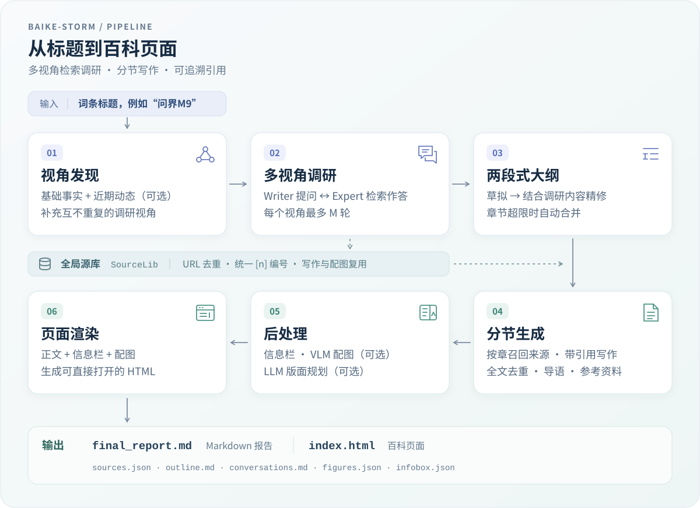

# baike-storm

中文百科词条生成工具：通过多视角检索、两段式大纲和分节写作，输出可直接阅读的百科风格 HTML 页面。

这是 [STORM](https://arxiv.org/abs/2402.14207) 的中文实现。LLM 网关、检索后端和评测 judge 均可替换；demo 模式可以离线跑通整条流水线。

## 流水线



产物写入 `runs/<词条>_storm/`，包括 Markdown 正文、HTML 页面和调研、配图等中间文件。

## 先看演示

- [打开 GitHub Pages 演示首页](https://zhaoxiaoyibing.github.io/baike-storm/)
- [阅读凯里·欧文完整词条](https://zhaoxiaoyibing.github.io/baike-storm/examples/kyrie-demo/)
- [在哔哩哔哩观看前端生成演示](https://www.bilibili.com/video/BV13kpz64EUp/)

<video controls preload="metadata" poster="https://zhaoxiaoyibing.github.io/baike-storm/examples/kyrie-demo/img/hero_3.jpg" width="100%">
  <source src="https://zhaoxiaoyibing.github.io/baike-storm/examples/frontend-demo/baike-storm-kyrie-demo.mp4" type="video/mp4">
  当前页面不支持内嵌播放，请打开<a href="https://zhaoxiaoyibing.github.io/baike-storm/examples/frontend-demo/">视频页面</a>。
</video>

<sub>前端生成流程 · 倍速配乐版 · 也可<a href="https://zhaoxiaoyibing.github.io/baike-storm/examples/frontend-demo/">打开独立视频页</a></sub>

<a href="https://zhaoxiaoyibing.github.io/baike-storm/examples/kyrie-demo/">
  
</a>

<sub>点击截图可打开完整词条页面。</sub>

## 特性

- **多视角调研**：`discover_perspectives` 规划 N 个互补视角。Writer 与 Expert 通过检索增强问答对话，把外部资料压缩成大纲和写作所需的上下文。
- **两段式大纲**：先草拟，再结合调研内容精修；章节数超上限时自动合并。
- **全局引用去重**：`SourceLib` 按 URL 去重并生成全局 `[n]` 编号，报告、信息栏和配图共用这套引用。
- **LLM judge 评测**：固定 rubric，按事实覆盖、准确性各 30%，结构、引用各 15%，可读性 10% 评分，并计算 `entity_recall` 关键事实召回率。
- **离线复现**：将 `STORM_LLM_BACKEND` 和 `STORM_SEARCH_BACKEND` 设为 `mock` 即可离线跑通；用 `STORM_TODAY` 固定运行日期，方便复现实验。
- **无内部依赖**：LLM 使用任意 OpenAI 兼容的 `chat/completions` 接口，检索后端和 judge 通过环境变量配置。

## 目录结构

```text
baike-storm/
├── pyproject.toml              # 打包、依赖和 baike-storm 命令
├── README.md
├── LICENSE                     # MIT
├── .env.example                # 环境变量模板
├── docs/
│   └── STORM_PLAN.md           # 流水线设计和评测口径
├── src/baike_storm/
│   ├── cli.py                  # 命令行入口：run / web / eval / render / demo
│   ├── config.py               # 配置和路径解析
│   ├── llm.py                  # OpenAI 兼容客户端和 MockLLM
│   ├── search.py               # Tavily 和 mock 检索后端
│   ├── storm_pipeline.py       # STORM 主流水线
│   ├── prompts_storm.py        # 提示词模板
│   ├── editorial.py            # 编辑指南解析
│   ├── score.py                # LLM judge 和 entity_recall
│   ├── figures.py              # 配图筛选、评分和版面规划
│   ├── infobox.py              # 信息栏字段提取
│   ├── render_baike_html.py     # Markdown → 百科风格 HTML
│   ├── webapp.py               # 聊天页后端（标准库 HTTP + SSE）
│   ├── static/index.html       # 聊天页前端
│   ├── skills/figure-layout/   # 版面规划提示词
│   └── data/
│       ├── editorial_guidelines.example.md   # 编辑指南格式示例
│       └── mock_corpus/                      # mock 检索语料
└── tests/                      # search / editorial / render / llm / pipeline
```

## 环境依赖

- Python ≥ 3.10
- 运行时依赖：`httpx`（唯一硬依赖）
- 真实 Tavily 检索：额外安装 `tavily-python`（可在 [tavily.com](https://tavily.com) 注册并获取 `TAVILY_API_KEY`）
- 可选依赖：`langsmith`（轨迹可视化）、`langchain-anthropic`（Anthropic judge）、`pytest`（测试）
- 一个 OpenAI 兼容的 LLM 服务（OpenAI、DeepSeek、本地 vLLM 或其他网关）
- 一个检索后端：
  - `tavily`：Tavily 搜索 API，需要 `TAVILY_API_KEY`。安装：`pip install -e ".[search]"`
  - `mock`：使用包内离线语料，不需要凭据

## 快速开始

### 安装

```bash
git clone <your-fork> baike-storm
cd baike-storm
pip install -e .             # 或 pip install -e ".[all]"（含 tracing、judge 和 tests）
```

### 离线演示

```bash
baike-storm demo 人工智能
# 指定输出目录
baike-storm demo 人工智能 --out /tmp/demo_run
```

`demo` 使用内置规则引擎（`MockLLM`）和 `mock_corpus/`，不会发起网络请求。运行几秒后，`runs/<词条>_demo/` 中会生成：

```text
final_report.md   # 报告正文（Markdown）
index.html        # 百科风格 HTML 页面
outline.md        # 草稿和精修后的大纲
conversations.md  # 调研对话
sources.json      # 全局源库
infobox.json      # 信息栏字段
figures.json      # 配图计划（默认为空）
```

### 配置真实服务

```bash
cp .env.example .env
# 按需填写，或直接 export 环境变量
```

| 变量 | 说明 |
| --- | --- |
| `STORM_LLM_BASE_URL` / `STORM_LLM_API_KEY` / `STORM_LLM_MODEL` | 主 LLM（OpenAI 兼容）；兼容旧变量 `OPENAI_*` 和 `RESEARCH_MODEL` |
| `STORM_SEARCH_BACKEND=tavily` + `TAVILY_API_KEY` | Tavily 检索 |
| `JUDGE_BASE_URL` / `JUDGE_API_KEY` / `JUDGE_MODEL` | `eval` 子命令使用的 judge |

## 使用示例

### 生成词条报告

```bash
# 词条 + 视角数 N + 每个视角的提问数 M（STORM 默认 N=5、M=3）
baike-storm run 问界M9 -n 5 -m 3

# 启用配图（需要配置 FIG_VLM_*）
baike-storm run 嫦娥六号 --figures

# Python 调用
python -c "
from baike_storm.storm_pipeline import run_storm_full
res = run_storm_full('问界M9', out_dir='runs/问界M9_storm', n=5, m=3)
print(res['report'])
"
```

产物位于 `runs/问界M9_storm/`。`final_report.md` 是主产物，`index.html` 可以直接在浏览器打开，包含配图、信息栏和引用。

### 启动聊天页（SSE 流式）

```bash
baike-storm web --port 8765
# 打开 http://127.0.0.1:8765/，输入词条即可查看生成过程
```

### 评测（LLM judge）

```bash
# gold/<title>.json 提供参考答案和 key_facts
baike-storm eval 嫦娥六号        # 自动查找 runs/嫦娥六号*/final_report.md
baike-storm eval 嫦娥六号 path/to/report.md
```

输出包括总分、五个维度的分数和理由，以及 `entity_recall`（关键事实命中率和未命中明细）。

`gold` 数据格式（不入库，请自行准备）：

```json
{
  "title": "嫦娥六号",
  "full_text": "……（百度百科原文，仅供 judge 使用，生成链路不可见）……",
  "key_facts": ["2024年5月3日，嫦娥六号由长征五号遥八运载火箭发射升空", "……"]
}
```

> `full_text` 只提供给 judge，不会进入生成链路；生成端的检索也不会读取参考答案。评测和生成使用独立的进程与配置，请勿混用。

### 渲染已有产物

```bash
baike-storm render runs/问界M9_storm    # 重新生成 index.html
```

## 流水线调优

调优针对提示词、检索参数和大纲策略，不涉及模型参数训练。

- **评测驱动迭代**：使用 `eval` 分数和 `entity_recall` 作为提示词、检索参数和大纲策略的比较依据。修改提示词后重新评测，再横向比较结果。
- **编辑指南**：`data/editorial_guidelines.example.md` 展示“大类 → 目录骨架 → 写作要点”的注入方式。将自己的分类体系整理成同格式文件，并用 `STORM_EDITORIAL_GUIDELINES` 指向它，`route_to_dalei` 会按大类加载对应骨架。
- **复现性**：
  - `STORM_TODAY=YYYY-MM-DD` 固定运行日期，影响“最新动态”视角和时间表述；
  - mock 后端输出确定，同一输入会产生同样的产物；
  - 检索和 LLM 通过环境变量配置，更换网关不需要修改代码。

## 常用配置

| 环境变量 | 默认值 | 说明 |
| --- | --- | --- |
| `STORM_LLM_BACKEND` | （空） | `mock` 使用离线规则引擎；缺省使用 OpenAI 兼容客户端 |
| `STORM_LLM_BASE_URL` / `STORM_LLM_API_KEY` / `STORM_LLM_MODEL` | - | 主 LLM；兼容 `OPENAI_*` 和 `RESEARCH_MODEL` |
| `STORM_SEARCH_BACKEND` | `tavily` | `mock` 读取 `data/mock_corpus/*.json` |
| `STORM_SEARCH_TOP_K` / `STORM_SECTION_TOP_K` | 4 / 14 | 视角检索和分节写作的召回条数 |
| `STORM_MIN_CHAPTERS` / `STORM_MAX_CHAPTERS` | 6 / 9 | 大章数范围，超上限时自动合并 |
| `STORM_NEWS` / `STORM_RECENT_DAYS` | 1 / 365 | “最新动态”视角开关和时间范围 |
| `STORM_FIG_PLAN` | 1 | 生成后进行版面规划；`0` 使用规则排版 |
| `JUDGE_BASE_URL` / `JUDGE_API_KEY` / `JUDGE_MODEL` | - | 评测 judge；`JUDGE_BACKEND=anthropic` 使用 Anthropic 协议 |
| `ENTITY_RECALL_LLM` | 1 | `0` 使用词法匹配判断事实，无需再次调用 LLM |
| `STORM_TODAY` | 今天 | 固定运行日期，用于复现实验 |
| `STORM_RUNS_DIR` / `STORM_GOLD_DIR` | `runs/` / `data/gold/` | 产物和评测目录 |

完整清单见 [.env.example](.env.example) 和 [src/baike_storm/config.py](src/baike_storm/config.py)。

## 测试

```bash
pip install -e ".[tests]"
python -m pytest          # 全部离线，不发起网络请求
```

## 公开演示

- [离线 HTML 示例](examples/ai-demo/index.html)
- [凯里·欧文 HTML 示例](examples/kyrie-demo/index.html)
- [前端配乐演示视频](examples/frontend-demo/index.html)
- [演示材料说明](examples/README.md)

启用 GitHub Pages 后可访问 <https://zhaoxiaoyibing.github.io/baike-storm/>。设置路径：仓库 **Settings → Pages → Build and deployment → Deploy from a branch**，选择 `main` 分支和 `/ (root)` 目录。

## 扩展

- **更换 LLM**：使用任意 OpenAI 兼容服务，配置 `STORM_LLM_*` 变量即可，具体见 `llm.py`。
- **更换检索**：实现 `search(query, top_k, with_images) -> list[dict]`，并在 `search.py` 中接入分发逻辑。mock 语料格式见 `data/mock_corpus/README.md`。
- **更换 judge**：`score.py` 支持 `openai`（默认）和 `anthropic` 两种协议端点。
- **接入自有词条体系**：将分类模板整理为编辑指南文件（格式见 `editorial_guidelines.example.md`），即可复用同类词条的分节规则。

## License

[MIT](LICENSE)
