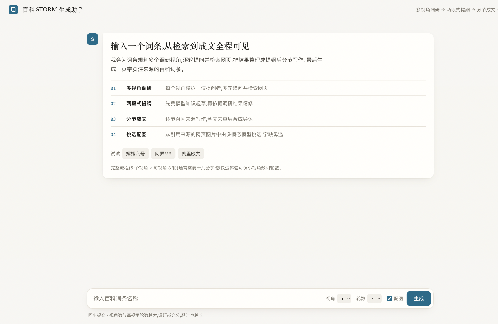

# baike-storm

中文百科词条生成工具：通过多视角检索、两段式大纲和分节写作，输出可直接阅读的百科风格 HTML 页面。

借鉴了 [STORM](https://arxiv.org/abs/2402.14207) 论文中的多视角调研和检索增强写作思路。

## 先看演示

- [阅读凯里·欧文完整词条](https://zhaoxiaoyibing.github.io/baike-storm/examples/kyrie-demo/)
- [](https://www.bilibili.com/video/BV13kpz64EUp/)

<video controls preload="metadata" poster="https://zhaoxiaoyibing.github.io/baike-storm/examples/kyrie-demo/img/hero_3.jpg" width="100%">
  <source src="https://zhaoxiaoyibing.github.io/baike-storm/examples/frontend-demo/baike-storm-kyrie-demo.mp4" type="video/mp4">
  当前页面不支持内嵌播放，请打开<a href="https://zhaoxiaoyibing.github.io/baike-storm/examples/frontend-demo/">视频页面</a>。
</video>

<a href="https://zhaoxiaoyibing.github.io/baike-storm/examples/kyrie-demo/">
  
</a>

<sub>点击截图可打开完整词条页面。</sub>

## 流水线


产物写入 `runs/<词条>_storm/`，包括 Markdown 正文、HTML 页面和调研、配图等中间文件。

## 特性

- **多视角调研**：`discover_perspectives` 规划 N 个互补视角。Writer 与 Expert 通过检索增强问答对话，把外部资料压缩成大纲和写作所需的上下文。
- **两段式大纲**：先草拟，再结合调研内容精修；章节数超上限时自动合并。
- **全局引用去重**：`SourceLib` 按 URL 去重并生成全局 `[n]` 编号，报告、信息栏和配图共用这套引用。

## 目录结构

```text
baike-storm/
├── pyproject.toml              # 打包、依赖和 baike-storm 命令
├── README.md
├── LICENSE                     # MIT
├── .env.example                # 环境变量模板
├── docs/
│   └── STORM_PLAN.md           # 流水线设计和评测口径
├── src/baike_storm/
│   ├── cli.py                  # 命令行入口：run / web / eval / render / demo
│   ├── config.py               # 配置和路径解析
│   ├── llm.py                  # OpenAI 兼容客户端和 MockLLM
│   ├── search.py               # Tavily 和 mock 检索后端
│   ├── storm_pipeline.py       # 内容生成流水线
│   ├── prompts_storm.py        # 提示词模板
│   ├── editorial.py            # 编辑指南解析
│   ├── score.py                # LLM judge 和 entity_recall
│   ├── figures.py              # 配图筛选、评分和版面规划
│   ├── infobox.py              # 信息栏字段提取
│   ├── render_baike_html.py     # Markdown → 百科风格 HTML
│   ├── webapp.py               # 聊天页后端（标准库 HTTP + SSE）
│   ├── static/index.html       # 聊天页前端
│   ├── skills/figure-layout/   # 版面规划提示词
│   └── data/
│       ├── editorial_guidelines.example.md   # 编辑指南格式示例
│       └── mock_corpus/                      # mock 检索语料
└── tests/                      # search / editorial / render / llm / pipeline
```

## 环境依赖

- Python ≥ 3.10
- 运行时依赖：`httpx`（唯一硬依赖）
- 真实 Tavily 检索：额外安装 `tavily-python`（可在 [tavily.com](https://tavily.com) 注册并获取 `TAVILY_API_KEY`）
- 可选依赖：`langsmith`（轨迹可视化）、`langchain-anthropic`（Anthropic judge）、`pytest`（测试）
- 一个 OpenAI 兼容的 LLM 服务（OpenAI、DeepSeek、本地 vLLM 或其他网关）
- 一个检索后端：
  - `tavily`：Tavily 搜索 API，需要 `TAVILY_API_KEY`。安装：`pip install -e ".[search]"`
  - `mock`：使用包内离线语料，不需要凭据

## 快速开始

### 安装

```bash
git clone https://github.com/zhaoxiaoyibing/baike-storm.git
cd baike-storm
python3 -m venv .venv
source .venv/bin/activate
python -m pip install -e .
```

以上虚拟环境激活命令适用于 macOS / Linux；Windows PowerShell 使用 `.\.venv\Scripts\Activate.ps1`。如需完整可选依赖，可安装 `python -m pip install -e ".[all]"`。

### 离线演示

```bash
baike-storm demo 人工智能
# 指定输出目录
baike-storm demo 人工智能 --out /tmp/demo_run
```

`demo` 使用内置规则引擎（`MockLLM`）和 `mock_corpus/`，不会发起网络请求。运行几秒后，`runs/<词条>_demo/` 中会生成：

```text
final_report.md   # 报告正文（Markdown）
index.html        # 百科风格 HTML 页面
outline.md        # 草稿和精修后的大纲
conversations.md  # 调研对话
sources.json      # 全局源库
infobox.json      # 信息栏字段
figures.json      # 配图计划（默认为空）
```

### 配置真实服务

在当前终端设置主 LLM 和 Tavily 凭据。请将下面的示例地址、密钥和模型名替换为服务商提供的实际值：

```bash
python -m pip install -e ".[search]"

export STORM_LLM_BACKEND=openai
export STORM_LLM_BASE_URL="https://api.example.com/v1"
export STORM_LLM_API_KEY="your-llm-api-key"
export STORM_LLM_MODEL="your-model-name"
export STORM_SEARCH_BACKEND=tavily
export TAVILY_API_KEY="your-tavily-api-key"

# 首次尝试：2 个视角，每个视角 1 轮提问，关闭配图
baike-storm run 凯里欧文 -n 2 -m 1 --no-figures
```

完成后，用浏览器打开 `runs/凯里欧文_storm/index.html`。在同一个终端执行 `baike-storm web --port 8765`，即可通过聊天页生成词条。

也可以复制 `.env.example` 为 `.env` 后填写配置。程序**不会自动加载 `.env`**，macOS / Linux 用户需在运行前手动导出：

```bash
cp .env.example .env
# 编辑 .env 并填写实际配置后执行
set -a
source .env
set +a
```

`.env` 已被 Git 忽略，密钥请保留在本地。上述最小配置用于正文生成；配图需要另外设置 `FIG_VLM_BASE_URL`、`FIG_VLM_API_KEY` 和 `FIG_VLM_MODEL`，评测需要单独配置 judge，详见 [.env.example](.env.example)。

### 运行时间与费用

真实生成的耗时取决于模型响应速度、网络状况、视角数、提问轮数、章节数和是否启用配图。默认 `-n 5 -m 3` 最多包含 15 轮调研对话，另有大纲和写作调用；演示视频经过倍速处理，其时长不代表实际生成耗时。

费用由所选服务商的模型 Token、检索调用和可选的图片模型调用计费决定，没有统一的单篇价格。建议先用 `-n 2 -m 1 --no-figures` 试跑，再结合服务商的用量记录增加调研深度。内置 mock 演示无需调用收费 API。

## 使用示例

### 生成词条报告

```bash
# 词条 + 视角数 N + 每个视角的提问数 M（默认 N=5、M=3）
baike-storm run 问界M9 -n 5 -m 3

# 启用配图（需要配置 FIG_VLM_*）
baike-storm run 嫦娥六号 --figures

# Python 调用
python -c "
from baike_storm.storm_pipeline import run_storm_full
res = run_storm_full('问界M9', out_dir='runs/问界M9_storm', n=5, m=3)
print(res['report'])
"
```

产物位于 `runs/问界M9_storm/`。`final_report.md` 是主产物，`index.html` 可以直接在浏览器打开，包含配图、信息栏和引用。

### 启动聊天页（SSE 流式）

```bash
baike-storm web --port 8765
# 打开 http://127.0.0.1:8765/，输入词条即可查看生成过程
```



### 评测（LLM judge）

```bash
# gold/<title>.json 提供参考答案和 key_facts
baike-storm eval 嫦娥六号        # 自动查找 runs/嫦娥六号*/final_report.md
baike-storm eval 嫦娥六号 path/to/report.md
```

输出包括总分、五个维度的分数和理由，以及 `entity_recall`（关键事实命中率和未命中明细）。

`gold` 数据格式（不入库，请自行准备）：

```json
{
  "title": "嫦娥六号",
  "full_text": "……（百度百科原文，仅供 judge 使用，生成链路不可见）……",
  "key_facts": ["2024年5月3日，嫦娥六号由长征五号遥八运载火箭发射升空", "……"]
}
```

> `full_text` 只提供给 judge，不会进入生成链路；生成端的检索也不会读取参考答案。评测和生成使用独立的进程与配置，请勿混用。

### 渲染已有产物

```bash
baike-storm render runs/问界M9_storm    # 重新生成 index.html
```

## 使用边界

- 生成内容和示例页面属于自动生成结果，事实、时效、引用与配图是否对应，需要在正式使用前人工核验；附带引用不等于事实已被确认。
- 示例图片版权归原作者或权利人所有，引用来源不代表获得转载授权。对外发布或商业使用时，请确认内容和图片的使用权限。

## 测试

```bash
pip install -e ".[tests]"
python -m pytest          # 全部离线，不发起网络请求
```

## 扩展

- **更换 LLM**：使用任意 OpenAI 兼容服务，配置 `STORM_LLM_*` 变量即可，具体见 `llm.py`。
- **更换检索**：实现 `search(query, top_k, with_images) -> list[dict]`，并在 `search.py` 中接入分发逻辑。mock 语料格式见 `data/mock_corpus/README.md`。
- **更换 judge**：`score.py` 支持 `openai`（默认）和 `anthropic` 两种协议端点。
- **接入自有词条体系**：将分类模板整理为编辑指南文件（格式见 `editorial_guidelines.example.md`），即可复用同类词条的分节规则。

## 参考与致谢

- [STORM 论文](https://arxiv.org/abs/2402.14207)
- [LangChain DeepAgents](https://github.com/langchain-ai/deepagents)
- [Taste Skill](https://github.com/leonxlnx/taste-skill)

## License

[MIT](LICENSE)
